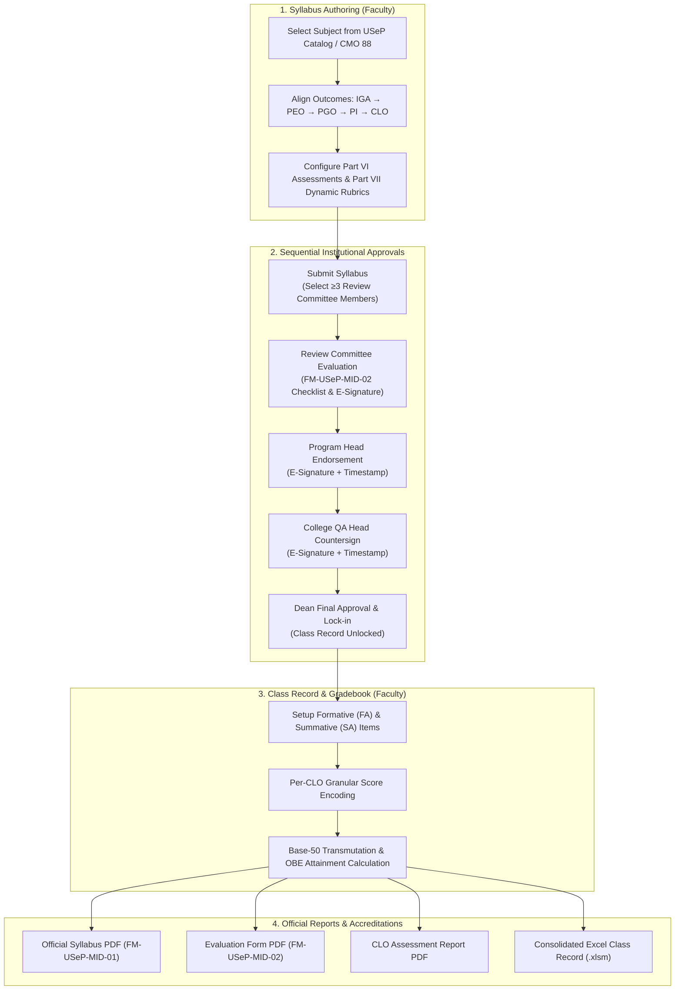

# USeP OBE Syllabus Creator & Consolidated Class Record Generator

An end-to-end Outcomes-Based Education (OBE) platform engineered for the **University of Southeastern Philippines (USeP) College of Engineering**. This system bridges the gap between **Course Syllabus Authoring (FM-USeP-MID-01)**, **Multi-Tier Institutional Approvals (FM-USeP-MID-02)**, **Rubrics Measurement Systems (Part VII)**, and **Consolidated Class Record Computation** with granular, per-CLO score tracking and official PDF/Excel report exports.

---

## 📑 Table of Contents
1. [System Architecture & Workflow Overview](#-system-architecture--workflow-overview)
2. [Quick Start & Installation](#-quick-start--installation)
3. [User Accounts, Roles & Permissions](#-user-accounts-roles--permissions)
4. [Step-by-Step User Guide](#-step-by-step-user-guide)
   - [Module 0: Class Analytics Dashboard](#module-0-class-analytics-dashboard)
   - [Module 1: Syllabus Creator Studio (FM-USeP-MID-01)](#module-1-syllabus-creator-studio-fm-usep-mid-01)
   - [Module 2: Dynamic Part VII Measurement System (Rubrics Creator)](#module-2-dynamic-part-vii-measurement-system-rubrics-creator)
   - [Module 3: 4-Stage Sequential Approval Workflow & Review Committee](#module-3-4-stage-sequential-approval-workflow--review-committee)
   - [Module 4: Requests for Approval Portal & Notifications](#module-4-requests-for-approval-portal--notifications)
   - [Module 5: Setup & Consolidated Class Record with Per-CLO Score Input](#module-5-setup--consolidated-class-record-with-per-clo-score-input)
   - [Module 6: Reports & Official Exports (PDF & Excel)](#module-6-reports--official-exports-pdf--excel)
5. [Managing Multiple Subjects Across School Years & Semesters](#-managing-multiple-subjects-across-school-years--semesters)
6. [Troubleshooting & Common FAQs](#-troubleshooting--common-faqs)

---

## 🏛️ System Architecture & Workflow Overview

The platform coordinates the academic lifecycle from syllabus inception to final transmuted grades and accreditation reporting:



---

## 🚀 Quick Start & Installation

### Prerequisites
- **Python 3.10+** installed on your system.
- Standard web browser (Google Chrome, Microsoft Edge, Mozilla Firefox).

### 1. Clone the Repository
```bash
git clone https://github.com/lordkelwin/class-record-generator-new.git
cd class-record-generator-new
```

### 2. Install Dependencies
Install all required libraries via `pip`:
```bash
pip install -r requirements.txt
```

### 3. Run the Application
Launch the Flask development server:
```bash
python app.py
```

### 4. Access the Platform
Open your browser and navigate to:
```
http://127.0.0.1:5000
```
Sign in using any of the default accounts listed below.

---

## 👥 User Accounts, Roles & Permissions

The platform enforces strict role-based access control (RBAC). A convenient **Role Test Switcher** is embedded in the top testing banner of Tab 1 for frictionless testing between signatories:

| Username | Password | Full Name | Official Role | Workflow Jurisdiction & Notes |
| :--- | :--- | :--- | :--- | :--- |
| `admin` | `admin123` | System Administrator | System Admin | Full administrative control, user account management |
| `faculty_tano` | `password123` | Engr. Elwin Jay J. Tano | Faculty Member | Authoring faculty in charge (EE Dept) |
| `committee_basan` | `password123` | Engr. Nikka Samantha A. Basan | Review Committee Chair | Evaluates *FM-USeP-MID-02* checklist and signs (EE) |
| `committee_arenga`| `password123` | Engr. Delan Zoe H. Arenga | Review Committee Member | Evaluates *FM-USeP-MID-02* checklist and signs (ECE) |
| `committee_ravida`| `password123` | Engr. Kim P. Ravida | Review Committee Member | Evaluates *FM-USeP-MID-02* checklist and signs (ECE) |
| `programhead_claro`| `password123` | Engr. Charito O. Claro, PECE | Program Head | Recommending approval and endorsement (EE) |
| `qahead_ce` | `password123` | Engr. College QA Head | College QA Head | Quality Assurance countersign (College of Engineering) |
| `dean_cataytay` | `password123` | Engr. Joie D. Cataytay, Ph.D. | College Dean | Final approval & lock-in *(Integrated real e-signature)* |
| `faculty_arcega` | `password123` | Engr. Sheena S. Arcega | Faculty Member | Sanitary Engineering *(Integrated real e-signature)* |

### Official College of Engineering Faculty Roster (1st Sem S.Y. 2026-2027)
Extracted directly from the official USeP roster document (`FACULTY PROGRAM LIST - 1ST  SEM S.Y. 26-27.docx.pdf`). All full-time faculty have review committee authorization for multi-tier syllabus review:

* **Electrical Engineering (EE):** Engr. Nikka Samantha A. Basan (FT), Engr. Charito O. Claro, PECE (Program Head), Engr. Ramil Alvin B. Ramos (FT), Engr. Elwin Jay J. Tano (FT), Engr. Donley Glenn Mabunga (FT), Engr. Jayson P. Lolo (PT).
* **Electronics Engineering (ECE):** Engr. Delan Zoe H. Arenga (FT), Engr. Roberto I. Canda (FT), Engr. Filmann T. Simpao (FT), Engr. Rosanna C. Ucat (FT), Engr. Kim P. Ravida (FT), Engr. Ernani Villasencio (FT), Engr. Kim Andripa (PT), Engr. Cherry Vic O. Camposo (PT), Engr. Hans Marc C. Simplicio (PT).
* **Mechanical Engineering (ME):** Engr. Aquileo B. Estrera (FT), Engr. Christopher C. Gonzales (FT), Engr. John Nerie L. Payao (FT), Engr. Dennis G. Rebuta (FT), Engr. Glemar O. Guarin (PT).
* **Geodetic Engineering (GE):** Engr. Pherly Grace I. Bungao (FT), Engr. Kevin G. Cañada (FT), Engr. Fillmore D. Masancay (FT), Engr. Niron James Abas (PT).
* **Mining Engineering (MinE):** Engr. Norvein L. Calibo (FT), Engr. Mark John S. Pag-alaman (FT), Engr. Elma Jane D. Rapal (FT / Program Head), Engr. Lorel M. Castillo (PT).
* **Geology (BSGeo):** Christian Paul F. Escarian (FT), Jerowen C. Licayan (FT), Marjorie T. Rebuyon (FT), Dean Lester P. Rejas (FT).
* **Civil Engineering (CE):** Engr. Bonifacio T. Aznar Jr. (FT), Engr. Maria Cynthia Donita Caparida (FT), Engr. Ma. Dely P. Esberto (FT), Engr. Jeremias M. Lawas (FT), Engr. Reymar S. Ledesma (FT), Engr. Eduardo S. Torrico Jr. (FT), Engr. Dalia M. Reconalla (FT), Engr. Ernesto B. Lim Jr. (PT), Engr. Florizel Ramas (PT), Engr. Maria Cynthia Donita Villasencio (PT).
* **Sanitary Engineering (SE):** Engr. Sheena S. Arcega (FT / E-Signature), Engr. Rheanie R. Arnuco (FT), Engr. Kathleen C. Cedeño (FT), Engr. Jayvee Moore S. Dy (PT).
* **Agricultural & Biosystems Engineering (ABE):** Engr. Ryan M. Abenoja (FT), Engr. Roland R. Bayron (FT), Engr. Ruben V. Cantones (FT), Engr. Joie D. Cataytay, Ph.D. (Dean / E-Signature), Engr. Alona J. Che-Tangyie (FT), Engr. Sheila C. Cogay (FT), Engr. Honeybee S. Limbaro (FT), Engr. Ronnie O. Lusares (FT), Engr. Roger C. Montepio, Ph.D. (FT), Engr. Renato C. Pareñas (FT), Engr. Teofilo Sevilla Jr. (FT), Engr. Kristine Faith Agato (PT), Engr. Ireneo P. Amplayo (PT), Engr. Irvin C. Generalao (PT), Engr. Filbert John Millan (PT), Engr. Ben-Hur C. Rofosala (PT), Engr. Aldrin I. Villacuer (PT).
* **College Staff:** Ayanekith L. Ababon (Technical Staff), Lemmor T. Benilan (Center Staff), Joyce Magdales (Technical Staff), Girlie Prevendido (Admin Aide IV), Reynaldo Eltagonde Jr. (Lab Tech), Hans Marc C. Simplicio (Lab Tech), Maxwell A. Soller Jr. (Technical Staff).

---

## 📖 Step-by-Step User Guide

### Module 0: Class Analytics Dashboard

Located on the **`📊 Dashboard`** tab, this live dashboard computes student performance metrics in real time from the Consolidated Class Record:
1. **Class Assessment Performance:** Bar charts comparing individual assessment averages against the passing threshold (50% raw points = 75 in Base-50).
2. **Individual Student Profile:** Select any student from the dropdown to review their breakdown across Formative (FA) and Summative (SA) tasks.
3. **Student × Assessment Heatmap:** Color-coded matrix indicating high achievers ($\ge 85\%$), proficient ($70-84\%$), developing ($50-69\%$), and at-risk students ($<50\%$).
4. **CLO Attainment vs. Target Standard:** Visual progress bars evaluating whether the class achieved the Target Degree of Attainment (e.g., 75%) and Target Percentage of Students (e.g., 70%).
5. **Outcome Alignment Chain Map:** Interactive interactive tracing from **Program Graduate Outcomes (PGO)** $\rightarrow$ **Performance Indicators (PI)** $\rightarrow$ **Course Learning Outcomes (CLO)**.

---

### Module 1: Syllabus Creator Studio (FM-USeP-MID-01)

Click tab **`1. Syllabus Creator, Course & CLO–PO–PI Setup`** to author or update a syllabus:

1. **Course & Faculty Information (Parts I & II):**
   - Select your **College**, **Department**, and **Course Code** (e.g., `AEE 321`).
   - The system automatically autofills the **Course Title**, **Credit Units**, **Lecture/Lab Breakdown**, **Prerequisites/Co-requisites**, and the official **Course Description** from the USeP course catalog based on **CMO 88 s. 2017** (BS Electrical Engineering).
   - Enter section, schedule, room, and semester/academic year.
2. **Course Learning Outcomes (CLOs) & OBE KPIs:**
   - Click **`+ Add CLO`** to define outcomes.
   - Click **`Browse Program Structure`** to open the reference drawer. Browse institutional attributes (IGAs), objectives (PEOs), and click **`+ Add as CLO`** on any Performance Indicator (PI) to automatically pull its text and mapping.
3. **Part V: Outline, Prerequisites & Sustainable Development Goals (SDG):**
   - Fill in prerequisite/co-requisite course matrices.
   - Tag United Nations SDGs (e.g., *SDG 7: Affordable and Clean Energy*, *SDG 9: Industry, Innovation, and Infrastructure*) with brief descriptions of alignment.
4. **Part VI: Assessment Tasks Table:**
   - Configure Formative (FA) and Summative (SA) assessments.
   - Assign assessment codes (e.g., `FA1`, `FA2`, `SA1`, `SA2`), descriptions, aligned CLOs, term weight percentages, and items per term.
   - Ensure the **`Auto-Link Syllabus → Class Record Setup`** checkbox is enabled so class record columns are generated automatically.

---

### Module 2: Dynamic Part VII Measurement System (Rubrics Creator)

Part VII defines the performance measurement rubrics that grade specific assessment activities:

#### Navigating to Part VII
- At the top of Tab 1, click the sticky blue button:
  $$\mathbf{📐\ Part\ VII:\ Measurement\ System\ (Rubrics)}$$
- Alternatively, in the Part VI assessment table, click any rubric link or click **`+ Add Rubric for Part of [Code]`**.

#### Configuring Graded Assessment Portions
A single major assessment activity (such as `SA1 - Quizzes` or `SA2 - Term Examination`) often contains diverse question types. In Part VII, faculty can specify the exact **Graded Assessment Portion / Sub-Component** (`target_part`):
- Click any quick preset chip or type custom text:
  - *Problem Solving Items*
  - *Short Essay Items*
  - *Practical Wiring / Hands-on Activity*
  - *Oral Recitation / Board Work*
  - *Entire Assessment*

#### Dynamic Columns (Performance Levels / Scale Points)
- **Add Column:** Click **`+ Add Level (Column)`** to append a new scale column.
- **Rename Headers:** Click directly into the column header to edit its label and point/percentage value (e.g., *Exemplary (4 pts / 100%)*, *Competent (3 pts / 85%)*, *Developing (2 pts / 70%)*, *Beginning (1 pt / 50%)*).
- **Reorder Columns:** Use `◀` / `▶` to shift columns left or right.
- **Delete Column:** Click `✕` on a column header to prune that level across all criterion rows safely without text corruption.
- **1-Click Scale Presets:** Initialize scales using the preset buttons:
  - *5-Point Scale (5 to 1)*
  - *4-Point Standard Scale (4 to 1)*
  - *3-Point Basic Scale (3 to 1)*
  - *Percentage Scale (100% to 50%)*

#### Dynamic Rows (Criteria / Areas to Assess)
- **Add Row:** Click **`+ Add Area / Criterion (Row)`**.
- **Configure Criterion:**
  - Enter the **Criterion Name** (e.g., *Mathematical Modeling*, *Circuit Analysis*, *Accuracy & Safety*).
  - Assign **Weight %** (e.g., 30%, 40%)—the rubric header automatically sums the total weight.
  - Choose the **Aligned CLO** from the dropdown.
  - Fill in descriptive descriptors in each level textarea.
- **Row Controls:** Shift rows up/down with `▲` / `▼` or delete with `✕`.

---

### Module 3: 4-Stage Sequential Approval Workflow & Review Committee

To lock in syllabus integrity and unlock the Class Record for grading, the syllabus must complete the official 4-stage sequential approval chain:

#### Step 1: Faculty Submission & Committee Composition
1. On Tab 1, click **`🚀 Submit for Committee Review`**.
2. A submission modal will appear requiring the **Review Committee Composition (Minimum 3 Members)**:
   - **Member 1 (👑 Chair / Lead Evaluator):** Select from registered faculty (default: `Engr. Nikka Samantha A. Basan`).
   - **Member 2:** Select second evaluator (default: `Engr. Delan Zoe H. Arenga`).
   - **Member 3:** Select third evaluator (default: `Engr. Kim P. Ravida`).
   - *(Optional)* Click **`+ Add Member`** if your department assigns 4 or 5 evaluators.
3. Enter optional **Faculty Submission Notes** (e.g., *"Updated OBE rubrics for 1st Semester A.Y. 2026-2027"*).
4. Click **`🚀 Submit Request & Notify Committee`**. The syllabus content is sealed with a SHA-256 integrity hash, and notifications are dispatched.

#### Step 2: Syllabus Review Committee Evaluation (FM-USeP-MID-02)
1. Log in as any assigned committee member (`committee_basan`, `committee_arenga`, or `committee_ravida`).
2. Open tab **`📥 Requests for Approval`** $\rightarrow$ click **`📝 Fill Review Checklist (FM-USeP-MID-02)`**.
3. Evaluate the **19 Core Statements** across Objectives, Outcomes, Content, and Rubrics as *Fully*, *Partially*, or *Not Met*, noting observed gaps.
4. Select the **Overall Recommendation**:
   - *Approved without revisions*
   - *Approved with minor revisions*
   - *Revise and resubmit*
5. Click **`✍️ Sign & Recommend Approval`** (or **`↩️ Return for Revision`** with remarks). The e-signature, name, and exact timestamp are sealed, advancing the request to the Program Head.

#### Step 3: Program Head Endorsement
1. Log in as `programhead_claro` (Engr. Charito O. Claro, PECE).
2. Open **`📥 Requests for Approval`** $\rightarrow$ review syllabus details and committee findings.
3. Click **`✍️ Sign & Endorse`** to apply digital endorsement and timestamp. The status advances to the College QA Head.

#### Step 4: College QA Head Countersign
1. Log in as `qahead_ce` (Engr. College QA Head).
2. Countersign the syllabus as compliant with college quality standards.
3. Click **`✍️ Sign & Countersign`**. The status advances to the Dean.

#### Step 5: Dean Final Approval & Lock-In
1. Log in as `dean_cataytay` (Engr. Joie D. Cataytay, Ph.D.).
2. Conduct final review and click **`✍️ Sign & Approve Syllabus`**.
3. **Outcome:**
   - The syllabus is officially **Approved & Locked 🔒**.
   - The **Consolidated Class Record** is instantly **unlocked** for student roster and score recording!
   - Official signature blocks on the PDF exports are finalized with all 4 signatory stamps and timestamps.

---

### Module 4: Requests for Approval Portal & Notifications

The **`📥 Requests for Approval`** tab serves as the centralized inbox for tracking academic workflows:

- **Active Notification Pill:** A red badge on the tab title (e.g. `📥 Requests for Approval [1]`) signals when an approval requires your immediate attention.
- **`⚡ Action Required` Filter:** Displays incoming submissions awaiting your review or endorsement, complete with requesting faculty name, submission timestamp, assigned committee roster, and 1-click action buttons.
- **`📋 My Submissions` Filter:** Enables faculty to track their submitted syllabi in real time:
  - **Pending Stage:** Shows `🟡 With Syllabus Review Committee (Assigned: Engr. N. Basan, Engr. D. Arenga, Engr. K. Ravida)` with exact submission timestamp and elapsed time.
  - **Completed Signatures:** Displays sealed signature cards with signatory names, official titles, electronic signature graphics, and verified timestamps.
  - **Withdraw Submission:** Allows faculty to recall a submission if still under initial review.
- **`🏛️ All Institutional` Filter:** Provides comprehensive administrative oversight of all course syllabi across departments.

---

### Module 5: Setup & Consolidated Class Record with Per-CLO Score Input

Once the syllabus is approved, navigate to **`2. Setup: Formative (FA) & Summative (SA)`** and **`3. Consolidated Class Record & CLO Grades`**:

#### Granular Per-CLO Score Input
If an assessment activity addresses multiple Course Learning Outcomes (e.g. a 100-point Midterm Exam covering **CLO 1** and **CLO 2**):
1. In **Tab 2 (Setup)**, specify the point distribution allocated to each aligned CLO (e.g. 50 points in CLO 1 and 50 points in CLO 2). The total points auto-sum.
2. In **Tab 3 (Class Record)**, the gradebook automatically generates **separate score input columns per aligned CLO** for that single assessment.
3. When recording scores, input student performance per CLO column. The class record sums raw scores and transmutes them accurately for granular OBE attainment analytics.

#### Class Record Lock Barrier
If the syllabus is still in `Draft` or `Pending Approval` status:
- Tabs 2 and 3 display a lock barrier banner:
  $$\mathbf{🔒\ Class\ Record\ Locked:\ Course\ syllabus\ must\ be\ approved\ by\ the\ Dean\ before\ recording\ grades.}$$
- Input fields remain read-only until the Dean seals final approval.

---

### Module 6: Reports & Official Exports (PDF & Excel)

All reports conform strictly to USeP institutional formatting:

1. **Official Syllabus PDF (FM-USeP-MID-01):**
   - Click **`Generate & Download Syllabus (.pdf)`** from Tab 1 or the sub-nav bar.
   - Exports landscape layout featuring institutional headers, complete course metadata, outcomes alignment matrices, Part V schedules, Part VII measurement rubrics, and the official 4-signature approval blocks with timestamps.
2. **Syllabus Review Checklist PDF (FM-USeP-MID-02):**
   - Click **`📋 Evaluation Form PDF`**.
   - Exports the 2-page evaluation document printing the 19 core statements, findings, and the **3 Review Committee members** side-by-side with signatures.
3. **CLO Assessment Report PDF:**
   - Click tab **`4. CLO Assessment Report & CO Tool`** $\rightarrow$ click **`Export CLO Assessment Report (.pdf)`**.
   - Generates the official report matching sample `AEE 321_EE 3A_CLO Report.pdf`, complete with batch degree of attainment percentages, target standards, and student-by-student outcomes.
4. **Excel Class Record (.xlsm):**
   - In Tab 3, click **`Export to Excel (.xlsm)`** to generate the university macro-enabled class record.

---

## 🗂️ Managing Multiple Subjects Across School Years & Semesters

Faculty frequently handle multiple subjects or multiple sections in an academic year:

1. **Collapsible Left Sidebar:**
   - Click the **`☰ Subjects`** button at the top left to expand or collapse the sidebar.
   - All your courses are grouped hierarchically by **School Year & Semester** (e.g., *A.Y. 2026-2027 • 1st Semester*).
2. **Adding a New Subject:**
   - In the sidebar header, click **`+ New Subject`**.
   - Choose **From USeP Catalog (Recommended)** to select from pre-loaded engineering programs (BSEE, BSCE, BSME, etc.) or choose **Blank / Custom Subject**.
   - Set the section and semester, then click **Create Subject**.
3. **Duplicating a Course for Another Section:**
   - Hover over any subject card in the sidebar and click the **Duplicate (Copy)** icon.
   - Choose a target section (e.g., duplicate `EE 3A` to `EE 3B`). The syllabus, rubrics, and CLO configurations are cloned instantly into an independent course record!

---

## 🔧 Troubleshooting & Common FAQs

### Q1: The browser shows the old version without Part VII rubrics or the approval stepper.
- **Cause:** Your browser cached earlier JavaScript/CSS files, or multiple stale Python background processes were active.
- **Solution:** 
  1. Perform a hard refresh: Press **`Ctrl + F5`** (or **`Ctrl + Shift + R`**).
  2. Alternatively, open `http://127.0.0.1:5000` in a **New Incognito / Private Window** (`Ctrl + Shift + N`).

### Q2: Why is the Class Record (Tabs 2 & 3) disabled or greyed out?
- **Cause:** The syllabus has not yet completed the 4-tier approval chain.
- **Solution:** Submit the syllabus for review and endorse through Dean approval using the test role switcher (`admin` can approve immediately for quick testing).

### Q3: How do I change the number of performance levels in a rubric?
- In **Tab 1 $\rightarrow$ Part VII**, locate your rubric and click **`+ Add Level (Column)`**. You can rename the scale header or delete unwanted columns with `✕`.

### Q4: Port 5000 is already in use error on startup.
- In PowerShell, run the following command to terminate orphan Python processes:
  ```powershell
  Get-CimInstance Win32_Process -Filter "Name = 'python.exe'" | Where-Object { $_.CommandLine -like "*app.py*" } | ForEach-Object { Stop-Process -Id $_.ProcessId -Force }
  python app.py
  ```

---

## 📜 Accreditation & Standards Compliance
- **CHED CMO No. 88, Series of 2017:** Policies, Standards, and Guidelines for Bachelor of Science in Electrical Engineering.
- **USeP OBE Framework:** Institutional Graduate Attributes (IGA1–IGA5), PEOs, PGOs, and Performance Indicators.
- **Forms FM-USeP-MID-01 & FM-USeP-MID-02:** Official syllabus outline and course review evaluation standards.
